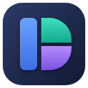

<p align="center">
  
</p>

<h1 align="center">Desk Helper</h1>

<p align="center">
  <b>WhatsApp, Telegram, Instagram, X, YouTube, tarayıcı, not defteri, dosya gezgini ve favori
  programlarınız — tek pencerede.</b><br>
  Tarayıcı gibi sekmeler, istediğiniz gibi bölünüp boyutlandırılan paneller, tek bir bildirim merkezi.
</p>

<p align="center">
  <a href="https://github.com/RbnApp/desk-helper/releases/latest"></a>
  <a href="#-gereksinimler"></a>
  <a href="LICENSE"></a>
  <a href="https://github.com/RbnApp/desk-helper/issues/new/choose"></a>
  <a href="https://www.electronjs.org/"></a>
</p>

---

## 🧭 Nedir?

Desk Helper, gün içinde ayrı ayrı açtığınız her şeyi tek pencereye toplar. Her uygulama kendi
sekmesinde ya da panelinde durur; panellerin yerini, boyutunu ve sırasını siz belirlersiniz.
Sekmeler ve açık sayfalar uygulama kapanınca hatırlanır.

## ✨ Özellikler

### 💬 WhatsApp, Telegram, Instagram, X
- Dördü de Desk Helper'ın içinde gömülü web paneli olarak açılır: web.whatsapp.com, web.telegram.org,
  instagram.com, x.com.
- Oturum kalıcıdır: bir kez giriş yaparsınız (WhatsApp ve Telegram'da QR ile), sonra açık kalır.
- Sekme değiştirme, panel taşıma ve boyutlandırma sorun çıkarmaz; görev çubuğunda ayrı simge oluşmaz.
- Instagram dar panelde telefon görünümünde açılır. X'e e-posta ve şifreyle girilir.
- Desk Helper kapalıyken bu servislerden bildirim gelmez.

### 🔔 Bildirim merkezi ve Rahatsız etme
- Sağ üstteki 🔔 zil, WhatsApp, Telegram, Instagram ve X'teki okunmamış sayıların toplamını gösterir.
- Tıklayınca servisler ayrı ayrı sayılarıyla listelenir; birine tıklayınca açık paneline geçilir
  (panel açık değilse yeni sekmede açılır).
- Zilin menüsündeki **Rahatsız etme** 1 saat, bugün boyunca ya da kapatana kadar bildirimleri ve sesleri susturur.

### ▶️ YouTube
- YouTube varsayılan olarak Desk Helper'ın içinde açılır; aynı anda birkaç video yan yana izlenebilir.
- Bir videoya sağ tıklayıp **Yeni panelde aç** derseniz (veya orta tıklarsanız) video yanına yeni panel olarak açılır.
- YouTube girişsiz kullanılır: Google, uygulama içine gömülü tarayıcılarda hesap girişine izin vermediği
  için Google hesabıyla giriş (YouTube, Gmail) desteklenmez. Video izlemek için giriş gerekmez.

### 🧭 Tarayıcı (Desk Helper'ın kendi tarayıcısı)
**Chrome, Opera veya Edge hiç kullanılmaz.** WhatsApp, Telegram ve diğer panellerdeki linkler, ↗ düğmesi,
sağ tık → **Tarayıcı panelinde aç** ve Favorilerdeki siteler Desk Helper'ın kendi tarayıcı panelinde yeni
sekme olarak açılır (sekmede tarayıcı paneli yoksa yanına açılır).

- 🧭 **Tarayıcı** kısayolu sekmeli bir tarayıcı paneli açar: sekmeler (+ , ✕, orta tık), geri / ileri / yenile,
  adres çubuğu (`localhost:3000` yazınca doğrudan açılır, adres değilse Google'da arar).
- Yeni sekmede açılan linkler aynı panelde yeni sekme olur; sağ tık → **Yeni panelde aç** yanına ayrı panel açar.
- 👤 düğmesinden profil seçilir: her profilin girişleri ve çerezleri ayrıdır, **Yeni profil…** ile eklenir.
  🕶 Gizli seçilirse hiçbir şey kaydedilmez.
- WhatsApp, Telegram ve Instagram panelleri tek sitelik "uygulama" panelidir: sekme ve adres çubuğu yoktur,
  başka siteye gitmezler; içlerindeki her link (yeni sekmede / yeni panelde aç dahil) tarayıcı paneline gider.
- Tüm web panellerinde sağ tık menüsü vardır: yeni sekmede aç, yeni panelde aç, tarayıcı panelinde aç,
  bağlantıyı kopyala, kes / kopyala / yapıştır.

#### 🔖 Yer imleri
- Yer imleri **profile bağlıdır**: adres çubuğunun altındaki çubukta yalnız seçili profilin yer imleri görünür.
- ☆ ile açık sayfa eklenir (★ ise düzenle / kaldır); tek tıkla açılır, Ctrl+tık veya orta tık yeni sekmede açar.
- Çubuğa sağ tıklayınca yeni klasör ve **Chrome'dan içe aktarma** çıkar (Chrome'da Yer işaretleri yöneticisi →
  ⋮ → Dışa aktar ile alınan HTML dosyası).
- Sürükle-bırak ile sıralanır; klasörün üstüne bırakılan yer imi klasöre girer.

#### 🍪 Çerez temizleme
- Yalnız açık sekmedeki sitenin (alan adı ve alt alan adları) çerezlerini o profilde temizler.
- Önce hangi çerezlerin silineceğini listeler ve onay ister; isterseniz o sitenin yerel verileri de silinir.
- Diğer siteler ve profiller etkilenmez.

### 🔐 Şifre yöneticisi (Chrome'dan bağımsız)
- Bir sitede giriş yapınca üstte **"Şifre kaydedilsin mi?"** çubuğu çıkar (Kaydet / Bu sitede asla / Şimdi değil).
  Aynı kullanıcı farklı şifreyle girerse "Şifre güncellensin mi?" sorulur.
- Kayıtlı siteye gelince tek hesap varsa kullanıcı adı ve şifre kendiliğinden dolar; birden çok hesap varsa
  alana tıklayınca seçim listesi çıkar.
- Şifreler profile bağlıdır ve Desk Helper'ın veri klasöründe (`passwords.json`) Windows'un kullanıcı
  şifrelemesiyle (DPAPI) saklanır. Chrome silinse de durur; başka bir Windows kullanıcısı veya bilgisayar çözemez.
- 👤 → **Kayıtlı şifreler…**: listele, göster, kopyala, düzenle, sil, "asla kaydetme" listesi ve Chrome'dan CSV
  içe aktarma (Chrome → Ayarlar → Şifre Yöneticisi → Ayarlar → Dışa aktar).
- Şifreyi göstermek/kopyalamak için ana parola istenir (ilk seferde belirlenir, 5 dakika açık kalır);
  otomatik doldurma ana parola istemez. Gizli pencerede şifre kaydedilmez.
- Adres çubuğundaki 🔑: bu sitenin kayıtlı hesapları (tıklayınca sayfaya doldurur) ve **Bu site için şifre ekle…**.
  Kayıtlı şifreler penceresinde de **+ Şifre ekle** vardır (site, kullanıcı adı, şifre).
- Not: phpMyAdmin zaten açık bir oturumla açılıyorsa (veya `auth_type = config` ile şifre sorulmuyorsa)
  giriş formu olmadığından kaydetme önerilmez; o zaman elle ekleyin.
- Gizli pencere varsayılan profilin yer imlerini gösterir. 👤 → **Bu profili sil…** profili, yer imlerini ve
  girişlerini siler.
- **+ Kısayol ekle** → **Tarayıcıda bir site** ile örneğin phpMyAdmin için tek tıklık kısayol eklenir;
  tıklayınca tarayıcı panelinde sekme açar.

### 🪟 Programlar panelde
**Kısayol ekle** ile eklenen programlar bilgisayarınızdaki gerçek programlardır. Desk Helper programın
penceresini bulur (açık değilse açar) ve panelin üstüne oturtur:

- Panel taşınınca, boyutlanınca, Desk Helper küçülünce pencere de takip eder.
- Başka sekmeye geçince o sekmenin pencereleri ekran dışına park edilir, geri dönünce yerine gelir.
- Paneldeki pencerenin görev çubuğunda ayrı simgesi olmaz; panelden ayrılınca (⇱) simge geri gelir.
- Program kendi oturumu, profili, sekmeleri ve eklentileriyle çalışır.
- ⇱ pencereyi panelden ayırır, ✕ paneli kapatır.
- Desk Helper kapanınca programlar serbest bırakılır. Beklenmedik kapanmada ekran dışında kalan pencereler
  bir sonraki açılışta geri getirilir.
- Doğru pencere bulunamazsa panel başlığındaki 🗗 düğmesi açık pencerelerden seçtirir.

**Sınır:** Windows, başka bir programın penceresini gerçekten gömmeye izin vermez; pencere panelin üstünde
durur. Bu yüzden Desk Helper'ın açılır pencereleri (Ayarlar, Favoriler…) açıkken paneldeki programlar geçici
olarak gizlenir.

## 🎛️ Kullanım

| Ne | Nasıl |
|---|---|
| **Sekmeler** | ＋ veya Ctrl+T yeni sekme açar ve ad sorar. Çift tık ya da sağ tık ile yeniden adlandırılır. Sekmede içindeki panellerin simgeleri görünür, üzerine gelince açık olanların listesi çıkar. Ctrl+Tab ile geçiş. |
| **Kısayollar** | Tıkla, aktif sekmeye panel eklenir. Sağ tık: panel ekle, alt çubuğa ekle, düzenle/sil. **+ Kısayol ekle** ile tarayıcıda açılan bir site, kurulu herhangi bir program ya da uygulama içi web sayfası eklenir. |
| **Dosyalar** | Windows 10 tarzı sağ tık menüsü: aç, not defterinde aç, kes/kopyala/yapıştır, yolu kopyala, sil (Geri Dönüşüm Kutusu'na), yeniden adlandır; boş alanda yeni klasör, yeni metin belgesi, yapıştır, yenile. Kısayollar: Del, F2, Ctrl+C/X/V, Ctrl+Shift+N, F5, Enter, Backspace (üst klasör). Paneller arası kopyala-yapıştır çalışır. |
| **Alt çubuk** | En altta, her sekmede görünen tek sıralık uygulama rafı. Bir kısayola veya favoriye sağ tık → **Alt çubuğa ekle**; çubuktaki simgeye sağ tık → **Alt çubuktan kaldır**. ＋ ile kısayollardan ve favorilerden seçilir ya da yeni program, klasör, web sitesi eklenir. **Kurulu uygulama** düğmesi Başlat menüsündeki tüm uygulamaları (Microsoft Store uygulamaları dahil) simgeleriyle ve arama kutusuyla listeler; exe dosyasını bulmanız gerekmez. Simgeler sürükleyerek sıralanır, sığmayınca fare tekerleği veya ‹ › ile yana kayar, üstüne gelinen simge büyür. |
| **Favoriler** | ⭐ veya Ctrl+Space: bilgisayarınızdaki programlar, dosyalar, klasörler ve siteler; tıklayınca açılır. |
| **Simgeler** | Sekmelerde, panel başlıklarında, kısayollarda ve alt çubukta gerçek logolar görünür. Beğenmediğiniz simgeye sağ tık → **Simgeyi değiştir…** ile kendi resminizi, bir emoji ya da harf + renk verebilirsiniz; "Varsayılana dön" geri alır. |
| **Yerleşim** | Sekmeler sürükle-bırak ile sıralanır. Paneli başlığından tutup başka panelin kenarına bırakınca yerleşir; ortasına bırakırsanız yer değiştirir. Aradaki çizgiyi sürükleyerek boyutlandırın, çift tık eşitler. |
| **Ayarlar ve Hakkında** | Sol üstteki Desk Helper düğmesi (sürüm numarası yanında yazar). Beş sekme: **Ayarlar** (dil Türkçe / English, tema ve tema rengi, açılışta pencere konumu, Windows ile başlat, her zaman üstte, not klasörü, açılışta güncelleme denetimi), **Kısayollar** (tuş listesi ve global tuşların durumu), **Bellek**, **Yenilikler** (sürüm notları), **Hakkında** (sürüm bilgisi, iletişim, GitHub deposu). |

## ⌨️ Kısayollar

Aşağıdaki tablo uygulamanın kendi kısayol tablosundan (`src/shared/shortcuts.js`) üretilir; elle düzenlenmez
(`npm run shortcuts:doc`). Kopyala, yapıştır, kes ve geri al gibi standart düzenleme tuşları işletim sisteminin
olduğu için listede yoktur. Ekran görüntüsü kısayolu başka bir program tarafından kullanılıyorsa Ayarlar bunu
söyler; görüntü 📷 düğmesinden de alınabilir.

<!-- KISAYOLLAR:BASLANGIC -->

| Kısayol · Shortcut | Ne yapar | What it does | Nerede · Where |
|---|---|---|---|
| `Shift+PrintScreen` | Ekran görüntüsü al | Take screenshot | Her yerde · Global |
| `Shift+F8` | Hava durumunu göster/gizle | Show/hide weather | Her yerde · Global |
| `Ctrl+T` | Yeni sekme | New tab | Uygulama penceresi · App window |
| `Ctrl+Space` | Favoriler | Favorites | Uygulama penceresi · App window |
| `Ctrl+Tab` | Sonraki sekme | Next tab | Uygulama penceresi · App window |
| `Ctrl+Shift+Tab` | Önceki sekme | Previous tab | Uygulama penceresi · App window |
| `F12` | Geliştirici araçları | Developer tools | Uygulama penceresi · App window |
| `Ctrl+Alt+1` | Çalışma alanı 1 | Workspace 1 | Uygulama penceresi · App window |
| `Ctrl+Alt+2` | Çalışma alanı 2 | Workspace 2 | Uygulama penceresi · App window |
| `Ctrl+Alt+3` | Çalışma alanı 3 | Workspace 3 | Uygulama penceresi · App window |
| `Ctrl+Alt+4` | Çalışma alanı 4 | Workspace 4 | Uygulama penceresi · App window |
| `Ctrl+Alt+5` | Çalışma alanı 5 | Workspace 5 | Uygulama penceresi · App window |
| `Ctrl+Alt+6` | Çalışma alanı 6 | Workspace 6 | Uygulama penceresi · App window |
| `Ctrl+Alt+7` | Çalışma alanı 7 | Workspace 7 | Uygulama penceresi · App window |
| `Ctrl+Alt+8` | Çalışma alanı 8 | Workspace 8 | Uygulama penceresi · App window |
| `Ctrl+Alt+9` | Çalışma alanı 9 | Workspace 9 | Uygulama penceresi · App window |
| `Ctrl++` | Yakınlaştır | Zoom in | İlgili panel · Focused panel |
| `Ctrl+-` | Uzaklaştır | Zoom out | İlgili panel · Focused panel |
| `Ctrl+0` | Normal boyut | Actual size | İlgili panel · Focused panel |
| `Ctrl+U` | Sayfa kaynağını görüntüle | View page source | İlgili panel · Focused panel |
| `Ctrl+R` | Yenile | Reload | İlgili panel · Focused panel |
| `Ctrl+Shift+R` | Önbelleksiz yeniden yükle | Reload ignoring cache | İlgili panel · Focused panel |
| `Ctrl+H` | Geçmiş | History | İlgili panel · Focused panel |
| `Ctrl+S` | Notu kaydet | Save note | İlgili panel · Focused panel |
| `Ctrl+Shift+N` | Yeni klasör | New folder | İlgili panel · Focused panel |
| `F5` | Yenile | Reload | İlgili panel · Focused panel |
| `F2` | Yeniden adlandır | Rename | İlgili panel · Focused panel |
| `Delete` | Sil | Delete | İlgili panel · Focused panel |
| `Backspace` | Üst klasör | Parent folder | İlgili panel · Focused panel |
| `Ctrl+S` | İşaretlemeyi kaydet | Save annotation | İlgili panel · Focused panel |

<!-- KISAYOLLAR:BITIS -->

## 🚑 Açılışta sorun olursa

- Desk Helper her sürüm yükseltmesinden önce kayıtlı düzenin yedeğini alır (uygulamanın veri klasöründe
  `state.backup-*.json`).
- Kayıtlı düzen yüklenemezse boş ekran yerine hata penceresi çıkar; **Düzeni sıfırla** sekmeleri ve
  kısayolları varsayılana döndürür. Favoriler, alt çubuk, yer imleri, tarayıcı profilleri ve ayarlar korunur.

## 🚀 Kurulum

1. GitHub'daki **Releases** sayfasından `DeskHelper-Setup-<sürüm>.exe` dosyasını indirin.
2. Kurulumu çalıştırın. Kurulum masaüstüne ve Başlat menüsüne (rbnbilisim klasörü) **Desk Helper**
   kısayolu ekler; kullanıcı hesabına kurulur, yönetici hakkı gerekmez.
3. Kaldırmak için: Ayarlar → Uygulamalar → Desk Helper.

Kurulum dosyası **imzasızdır**; Windows SmartScreen "Yine de çalıştır" isteyebilir. Bu beklenen durumdur.

Desk Helper açılışta yeni sürümü kendisi denetler, sürüm notlarını gösterip onay isteyerek indirir ve kurar
(Ayarlar → Hakkında → Güncellemeleri denetle). Güncelleme dosyaları GitHub Release'e yüklenir
(`DeskHelper-Setup-<sürüm>.exe`, `.blockmap`, `latest.yml`); uygulama güncellemeyi buradan bulur.

## 📋 Gereksinimler

| Gereksinim | Neden |
|---|---|
| Windows 10 veya Windows 11, x64 | Kurulum paketi x64 NSIS olarak üretilir (`package.json` → `build.win`). |
| İnternet | WhatsApp, Telegram, Instagram, X ve YouTube web panel olarak açılır. |

Uygulamayı çalıştırmak için ayrıca bir kurulum adımı ya da hesap gerekmez; yalnız geliştirmek için
**Node.js** gerekir (aşağıdaki bölüm).

## 💬 Geri bildirim

- Uygulamada **Hakkında → Geri bildirim gönder** düğmesi vardır; tarayıcıda GitHub'ın "yeni issue" sayfasını açar.
- Önceden doldurulan tek bilgi sürüm ve Windows sürümüdür; kimlik, makine adı, kullanıcı adı, dosya yolu,
  ayar ve günlük gönderilmez.
- Doğrudan bağlantı: [RbnApp/desk-helper · Issues](https://github.com/RbnApp/desk-helper/issues/new).

## 🔢 Sürüm

Biçim **ANA.ARA.YAMA**'dır (şu an: `0.4.4`). YAMA artar; 9'dan sonra ARA'ya, ARA 9'dan sonra ANA'ya devreder
(0.4.9 → 0.5.0, 0.9.9 → 1.0.0). Tek kaynak `package.json:3`; kural ve nasıl uygulanacağı:
[VERSIONING.md](VERSIONING.md). Sürüm numarası yalnız yeni bir yapı yayımlanırken artırılır; sürüm notları
[CHANGELOG.md](CHANGELOG.md) içinde tutulur.

## 📄 Lisans

MIT — ayrıntılar için [LICENSE](LICENSE). Telif: © 2026 rbnbilisim.

## 🛠️ Geliştirme

Node.js gerekli. Bu klasörde:

```powershell
npm install     # bağımlılıkları kur
npm start       # geliştirme modunda aç (F12: geliştirici araçları)
npm run bump    # sürümü kurala göre artır
npm run dist    # dist\ içine kurulum dosyası üret
```

Duman testi: `node scripts/duman.js --etiket once|sonra` — uygulamayı ayrı bir geçici profille açar,
gerçek fare olaylarıyla temel akışları dener, konsol hatalarını sayar ve ekran görüntüsü alır.

| Yol | İçerik |
|---|---|
| `src/main/` | Ana süreç: `main.js` (pencere, dosya sistemi, ayarlar), `native.js` (gerçek program pencereleri, Win32), `widgets.js` + `boxes.js` (masaüstü bileşenleri), `sysinfo.js`, `shots.js`, `passwords.js`, `motion.js` |
| `src/preload/` | Köprüler: `preload.js`, `webview-preload.js`, `sw-preload.js`, `shot-preload.js`, `widget-preload.js` |
| `src/renderer/` | Arayüz: `index.html`, `app/` (parçalar `cekirdek.js` → `baslat.js` sırasıyla yüklenir), `annotate.js`, `yt-player.html`, `shot.html`, `logo.png`, `vendor/` |
| `src/widgets/` | Bileşen pencereleri: `widget-sys.*`, `widget-box.*`, `widget.css`, `widget-theme.js` |
| `src/shared/` | İki ya da daha çok süreçte kullanılanlar: `style.css`, `i18n.js`, `menu.js`, `modal.js`, `tr-cities.js` |
| `build/`, `scripts/` | `icon.ico` (uygulama simgesi), `bump.js` (sürüm), `duman.js` (duman testi) |

### 🧰 Geliştirici notu: pencere (modal) motoru

Uygulamadaki bütün açılır pencereler (onaylar, formlar, çerez temizleme, şifreler, Favoriler, Ayarlar,
alt çubuk…) tek motordan açılır: `src/shared/modal.js` (`Modal.open / form / confirm / alert / choose`).
Bütün sağ tık ve açılır menüler de tek bileşenden: `src/shared/menu.js` (`PopMenu.open`, stil `.pm-*`).
Görünüm `style.css` içindeki "Modal motoru" bölümündedir (`.mdl-*`). Tasarım ya da klavye davranışı
(Enter, Esc, Tab) değişecekse yalnızca bu iki yer değişir.

---

<p align="center"><sub>© 2026 rbnbilisim · Desk Helper · info@rbnbilisim.com.tr</sub></p>
